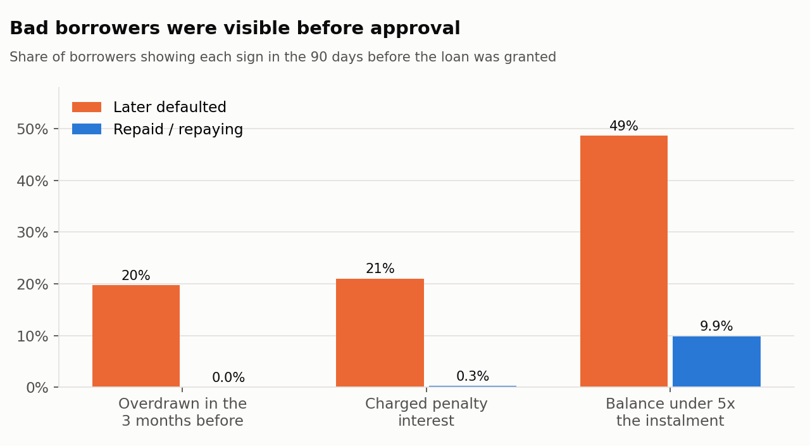
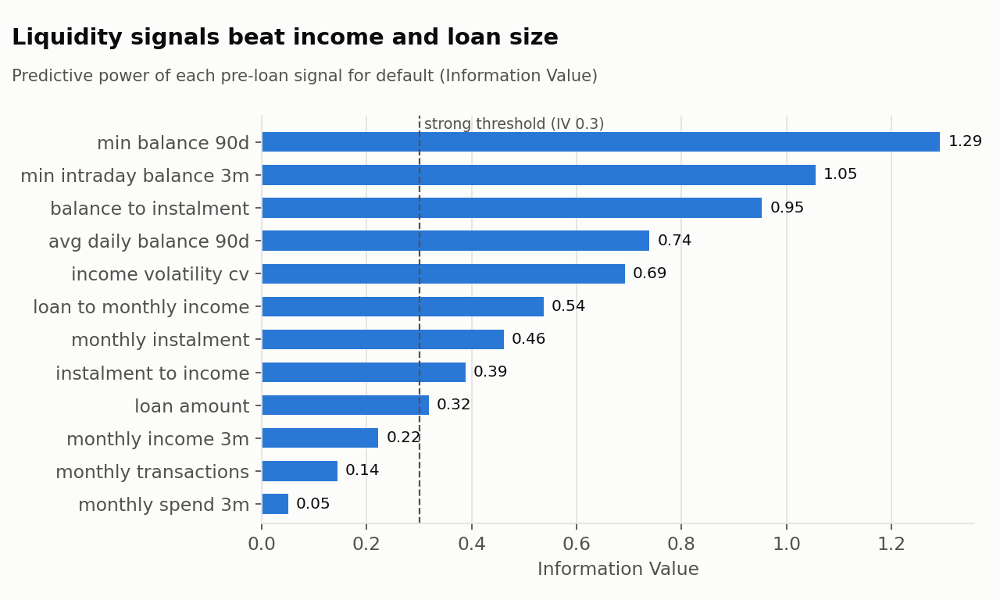
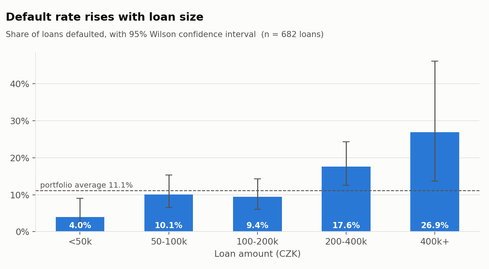
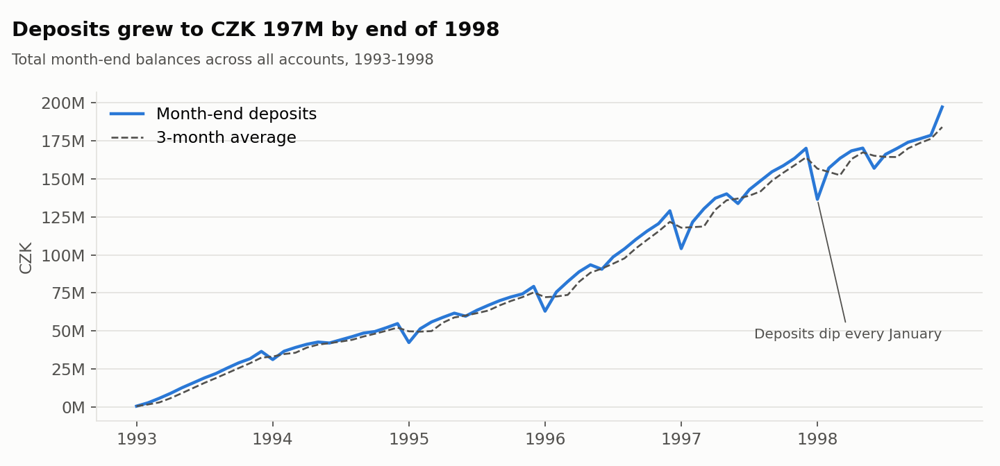
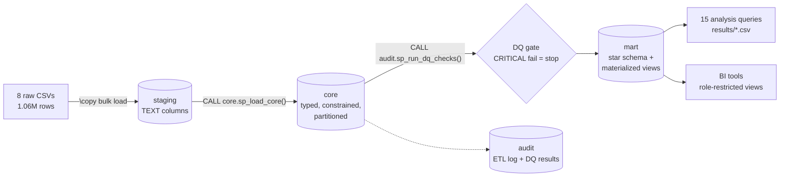
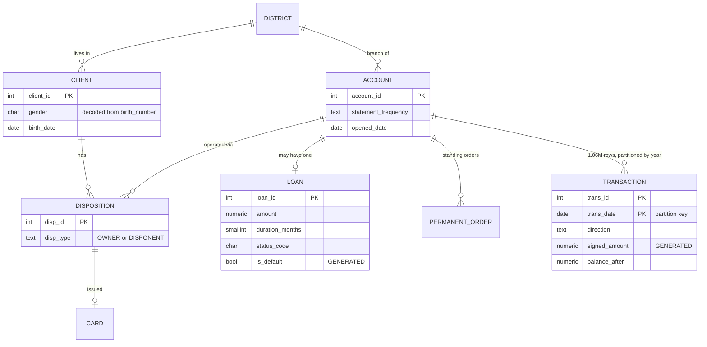

# Retail Bank Analytics Warehouse — PostgreSQL

**An end-to-end SQL project on 1 million+ real banking transactions.** Raw CSVs are ingested, cleaned and validated, modelled into a star schema, and analysed to answer 15 business questions for credit risk, collections, fraud, marketing and finance teams.

   

---

## The business problem

A Czech retail bank wants to improve its services. Management knows little about its customers, while the loan book carries an **11.1% bad-loan rate (15.1% by value)**. The bank wants to know:

1. **Credit risk:** could the bad loans have been spotted **at approval time**?
2. **Collections:** which running loans need attention now?
3. **Fraud:** which transactions fall far outside a customer's own normal behaviour?
4. **Growth:** who are the valuable customers, and who should get a card or loan offer?

The data is the **real, anonymised PKDD'99 "Berka" dataset**: 5,369 clients, 4,500 accounts, 682 loans and 1,056,320 transactions from 1993 to 1998.

---

## Headline findings

| # | Finding | So what |
|---|---|---|
| 1 | **1 in 5 defaulters was overdrawn in the 90 days before their loan was approved. Not one good borrower was.** 21% had already been charged penalty interest, versus 0.3% of good borrowers. | Two cheap rules on data the bank already holds would have flagged about a quarter of defaults. |
| 2 | **Liquidity beats income.** The lowest balance in the 90 days before the loan is the strongest risk signal (IV 1.29, AUC 0.80). Income alone is only medium strength (IV 0.22). | Underwriting should look at balance behaviour, not just salary. |
| 3 | A **3-signal SQL scorecard** scores **AUC 0.79 on held-out loans**. Declining the lowest-scoring 20% would have caught **52% of test-set defaults** and cut the default rate from **14.1% to 8.8%**. | A transparent, auditable model built in SQL alone, with no ML platform needed. |
| 4 | Default rate climbs with loan size: **4% under 50k CZK, 27% above 400k CZK**. Borrower age, gender and loan term make no significant difference. | Tighten affordability checks for large loans. Don't segment on demographics. |
| 5 | **Local economics explain almost nothing.** District salary and unemployment have r² ≤ 0.03 against both default rate and balances. | Regional risk pricing is not justified. Price on the individual's behaviour. |
| 6 | Defaulted loans make their **first repayment later** (median 21–24 days after approval, versus 11–14 for good loans). **27–36% of bad loans pay first after 40 days**, versus under 1% of good ones. | A late first instalment is a cheap early-warning trigger for collections. |
| 7 | **Pension customers are 16% of accounts but hold zero loans and almost no cards** (18 of 740). | An untapped, under-served segment for product teams. |
| 8 | A naive analysis says card holders rarely default (2.9% vs 11.1%). **That is mostly data leakage:** only 36 of the 170 card-holding borrowers had the card *before* the loan. | Point-in-time discipline changes the conclusion. This is shown explicitly in Q02. |
| 9 | The behavioural anomaly model raises **about 1,770 alerts over 6 years (about 1 per business day)**. The top alerts are cash withdrawals 15–45 times the customer's usual amount. | A review-queue volume a small fraud team can actually clear. |

<p align="center"></p>
<p align="center"></p>
<p align="center"></p>
<p align="center"></p>

---

## Architecture



| Layer | Purpose | Key techniques |
|---|---|---|
| `staging` | Land files 1:1. Every column is `TEXT`, so a bad value never breaks the load. | `\copy`, row-count logging |
| `core` | Cleaned 3NF model with English labels | PK/FK/CHECK constraints, partial unique index, **generated columns**, **yearly range partitioning**, data-driven code translation, stored procedure with step logging |
| `audit` | Pipeline observability | ETL run log with durations, 19 automated data-quality checks, a build-failing gate |
| `mart` | Analytics: star schema, pre-aggregates, feature store, scorecard | Materialized views with unique indexes (concurrent refresh), gaps-and-islands carry-forward, point-in-time features |

### Data model (core)



---

## The 15 business questions

| Query | Question | Stakeholder | Advanced SQL used |
|---|---|---|---|
| [Q01](sql/06_analysis/q01_portfolio_snapshot.sql) | Executive portfolio snapshot | Head of Retail | `FILTER`, `PERCENTILE_CONT` |
| [Q02](sql/06_analysis/q02_default_drivers.sql) | What drives default, and is it statistically significant? | Credit Risk | `GROUPING SETS`, `GROUPING()`, Wilson 95% CI function, point-in-time join |
| [Q03](sql/06_analysis/q03_pre_loan_behaviour.sql) | Did bad borrowers look different *before* approval? | Underwriting | point-in-time feature store, `LATERAL VALUES` unpivot/pivot |
| [Q04](sql/06_analysis/q04_risk_signal_strength.sql) | Rank every risk signal by predictive power | Risk Modelling | **Weight of Evidence, Information Value, AUC via Mann-Whitney ranks**, in pure SQL |
| [Q05](sql/06_analysis/q05_scorecard_validation.sql) | Does a SQL scorecard work on unseen loans? | CRO | train/test split, AUC, **KS statistic**, policy simulation with `PERCENT_RANK` |
| [Q06](sql/06_analysis/q06_repayment_tracking.sql) | Schedule vs actual repayments, arrears, early warning | Collections | **`WITH RECURSIVE`** amortisation schedule, `LAG` payment gaps |
| [Q07](sql/06_analysis/q07_rfm_segmentation.sql) | RFM customer segmentation | Marketing / CRM | `NTILE`, segment rules, share-of-total windows |
| [Q08](sql/06_analysis/q08_cohort_balance_maturity.sql) | How fast do new accounts build deposits? | Product / Finance | cohort pivot on a dense month spine |
| [Q09](sql/06_analysis/q09_deposit_trend.sql) | Deposit growth: MoM, YoY, smoothed | Treasury | `LAG(…,12)`, `ROWS` moving average, running totals |
| [Q10](sql/06_analysis/q10_regional_performance.sql) | Best and worst districts | Regional Network | `RANK`, `DENSE_RANK … PARTITION BY`, benchmark vs region |
| [Q11](sql/06_analysis/q11_economic_drivers.sql) | Do local economics explain value or risk? | Strategy | `CORR()`, `REGR_R2()` |
| [Q12](sql/06_analysis/q12_transaction_anomalies.sql) | Unusual withdrawals for fraud/AML review | Financial Crime | **time-based `RANGE INTERVAL '180 days' PRECEDING` window**, z-scores |
| [Q13](sql/06_analysis/q13_cross_sell_targets.sql) | Who should get a card or loan offer? | Sales | data-driven thresholds, `NOT EXISTS`, `ROW_NUMBER` per region |
| [Q14](sql/06_analysis/q14_product_penetration.sql) | Product-holding matrix, pensioners vs others | Product | `CUBE` with subtotals |
| [Q15](sql/06_analysis/q15_customer_360.sql) | Customer 360 for a collections agent | Operations | set-returning function + `CROSS JOIN LATERAL` |

The output of every query is committed in [`results/`](results/), so you can read the answers without running anything.

---

## Engineering highlights

- **Data quality as code.** `audit.sp_run_dq_checks()` runs 19 checks: row-count reconciliation for every table, unmapped source codes, one owner per account, loan arithmetic (amount = term × instalment), temporal logic (nothing happens before an account opens), age plausibility, and a **ledger reconciliation**, which confirms 99.87% of account-days balance to within 1 CZK. A `CRITICAL` failure stops the build. See [`sql/04_quality`](sql/04_quality).
- **Reconstructing what the source lacks.** Transactions have no intra-day order. The true end-of-day balance is rebuilt from the balance chain: the closing transaction is the one whose balance is not the opening balance of another same-day transaction.
- **No look-ahead bias.** Loan features use only data from *before* the approval date. Q02 shows how ignoring this reverses a conclusion about card holders.
- **Performance** ([details](docs/performance.md)):
  - A covering composite index makes the hot-path query **47× faster** (16.4 ms → 0.35 ms).
  - Partition pruning skips 5 of the 6 years.
  - Materialized views are **7.6× faster** than aggregating raw data.
  - Rewriting a correlated subquery as a hash join took one build step from over 2 minutes to 10 seconds.
- **Security** ([`sql/07_security`](sql/07_security)):
  - Least-privilege roles.
  - A `security_barrier` view that restricts regional analysts to their own region's rows, with entitlements stored as data.
  - A PII-minimised client view (birth year only).
- **Reproducible.** Docker Compose, a Makefile, and GitHub Actions CI that rebuilds the warehouse on a 10% referentially consistent sample and runs every query on each push.

---

## Run it

```bash
# 1. Start PostgreSQL 16
docker compose up -d --wait

# 2a. Full dataset: put the 8 CSVs in data/raw/ (see data/raw/README.md)
make all             # pipeline + 15 queries -> results/*.csv + charts

# 2b. Or, with no download, use the committed 10% sample
make sample && make analysis
```

**On Windows without Docker or bash:** install PostgreSQL 16, open **SQL Shell (psql)**, connect, then run:

```sql
CREATE DATABASE berka;
\c berka
\cd 'C:/path/to/berka-bank-analytics'
\i build_all.sql
```

Full rebuild takes about 31 seconds. All 15 queries together take about 3 seconds.

```text
.
├── sql/
│   ├── 01_setup/       schemas + audit tables
│   ├── 02_staging/     raw landing tables + \copy load
│   ├── 03_core/        typed model, parsing functions, ETL procedure, indexes
│   ├── 04_quality/     DQ framework + build gate
│   ├── 05_mart/        star schema, facts, functions, feature store, scorecard
│   ├── 06_analysis/    q01–q15 business questions
│   └── 07_security/    roles, row-restricted view, PII masking
├── scripts/            run_pipeline.sh, run_analysis.sh, make_sample.py, make_charts.py
├── results/            committed CSV output of every query
├── docs/               data dictionary, performance notes, charts
├── data/sample/        10% sample used by CI
├── docker-compose.yml  Makefile  .github/workflows/ci.yml
```

---

## Limitations and honest caveats

- **Small default count.** There are 76 defaults in total and 31 in the test set, so the scorecard's test metrics carry wide uncertainty. The train-to-test drop in AUC (0.885 → 0.792) shows some overfitting. In production you would use out-of-time validation and monotonic coarse-classing of bins.
- **Joint accounts.** Joint-account borrowers have zero defaults out of 145. The dispositions table has no dates, though, so this can't be checked point-in-time and shouldn't be used for approval decisions without that date.
- **Survivorship.** The extract appears to contain only accounts still open in 1998, which is why almost every account is active every month. Q08 therefore measures balance maturity rather than churn.
- **Rounding.** The source ledger has sub-crown rounding drift on interest postings, so reconciliation uses a 1 CZK tolerance.

---

*Data: PKDD'99 Discovery Challenge, Financial dataset (Berka, 1999), public for research and education. See the [CTU Relational Dataset Repository](https://relational.fel.cvut.cz/dataset/Financial).*
